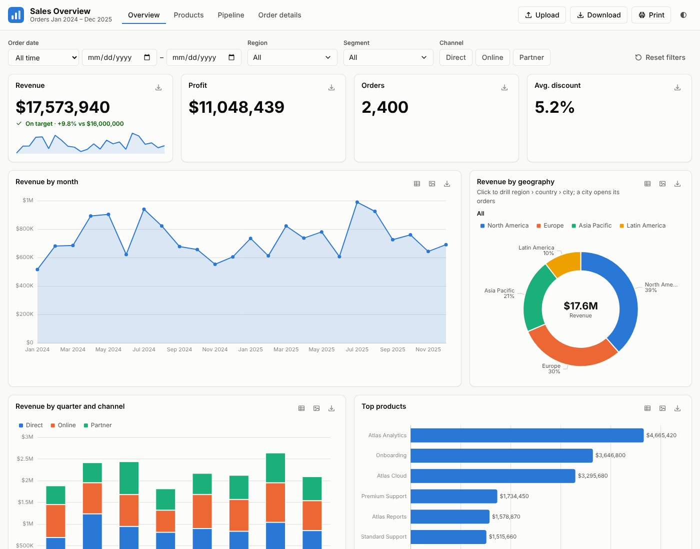
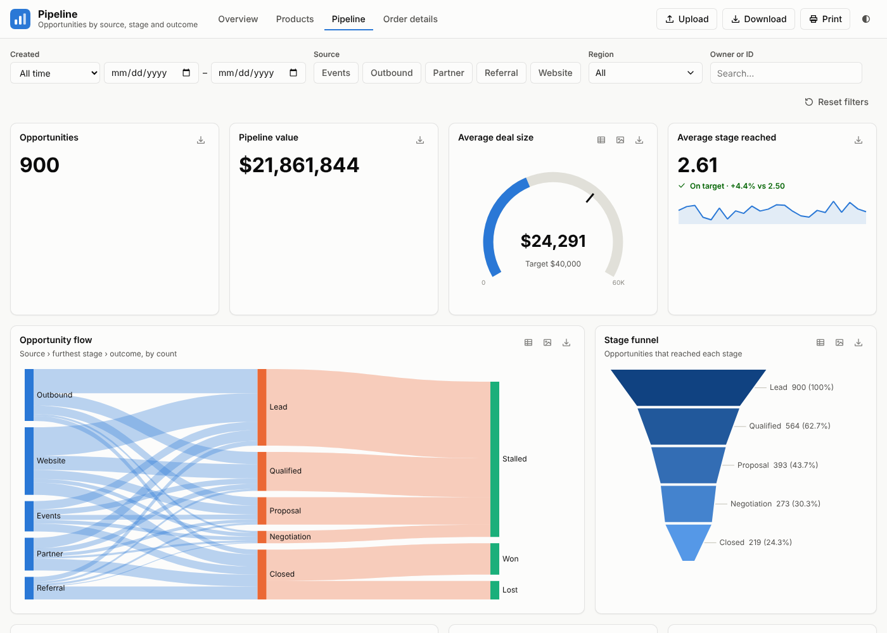
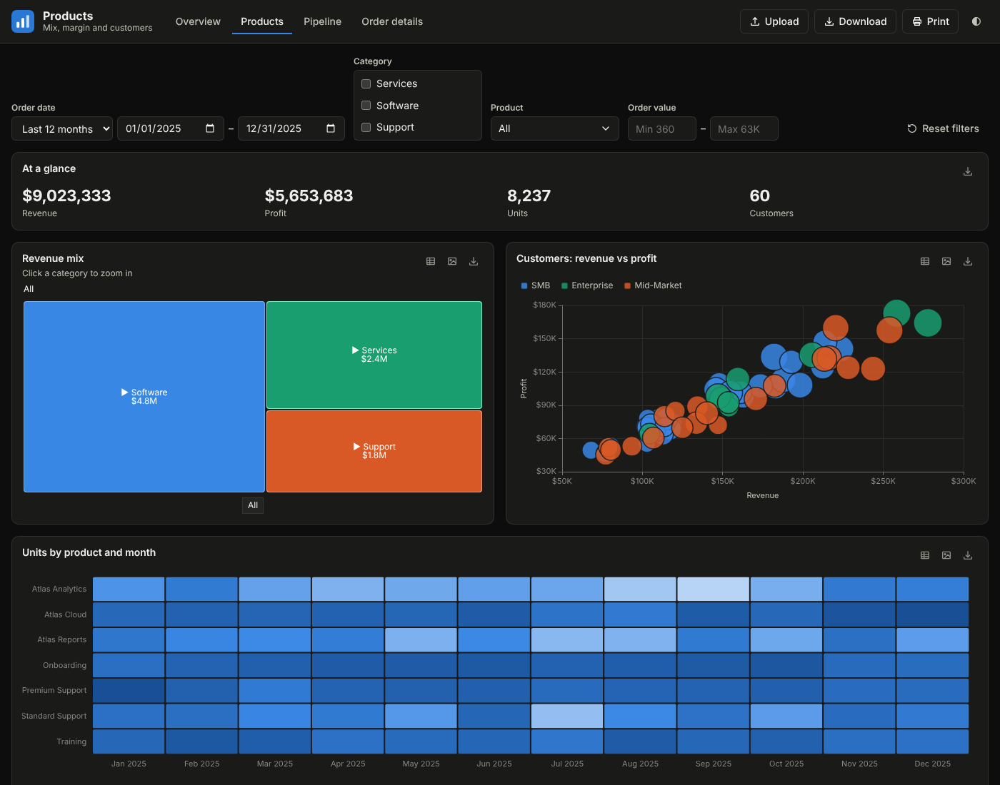

# Atlas HTML Charts


**Business dashboards as plain HTML files.** Describe a dashboard in a block of JSON, open the file in a browser,
get a complete page: your logo top-left, page navigation, **Upload / Download / Print** buttons, Power BI-style
slicers and a responsive grid of interactive visuals, including **Sankey flows** and **drill-down / drill-through pie charts**.

Built to be assembled by people *and* by AI assistants: one template, one schema, one reference, and a prompt library,
so the same request produces the same quality of dashboard every time.



---

## Overview

- **No build, no server, no framework.** Copy a template, point it at a data file, double-click. Works from `file://`,
  a file share, SharePoint, GitHub Pages or any static host. ECharts is vendored, so it works offline.
- **Config, not code.** Every page is a JSON block validated by a [JSON Schema](schema/dashboard.schema.json).
- **The Power BI visual set**, by Power BI's own names, plus Sankey, sunburst, heatmap and drill pies.
  See the [mapping](docs/powerbi-mapping.md).
- **Interactive like a BI tool.** Click to cross-filter, drill down in place, drill through to detail pages,
  share filtered views as URLs.
- **Accessible and printable.** Every chart has a data-table view; colours are colour-blind-safe in light and dark mode;
  charts stay still for viewers who turn on reduced motion; print/PDF output lists the active filters.
- **AI-ready.** [`AGENTS.md`](AGENTS.md) tells an assistant exactly how to build pages; [`prompts/`](prompts/) has
  ready-made prompts for new dashboards, Power BI ports, themes and reviews.

---

## Quick start

```bash
git clone https://github.com/DataChart/AtlasHTMLCharts.git
cd AtlasHTMLCharts
cp templates/dashboard.html dashboards/my-dashboard.html
```

Open `dashboards/my-dashboard.html` in your browser. Then edit its config block:

```html
<script src="my-data.js"></script>   <!-- Atlas.registerData("orders", [ {...}, ... ]) -->

<script type="application/json" data-atlas>
{
  "title": "Order to Cash",
  "logo": "../assets/logo.svg",
  "nav": [{ "label": "Overview", "href": "my-dashboard.html" }, { "label": "Invoices", "href": "invoices.html" }],
  "data": "orders",
  "fields": { "amount": { "format": "currency" } },
  "filters": [
    { "type": "dateRange", "field": "orderDate" },
    { "type": "dropdown", "field": "region" }
  ],
  "visuals": [
    { "type": "kpi", "title": "Billed", "value": "amount", "target": 1200000, "trend": "orderDate", "span": 3 },
    { "type": "line", "title": "Billed by month", "category": "orderDate", "value": "amount", "span": 9 },
    { "type": "sankey", "title": "Order flow", "levels": ["channel", "status", "paymentTerms"], "value": "amount", "span": 8 },
    { "type": "drillDonut", "title": "By geography", "levels": ["region", "country"], "value": "amount", "span": 4 }
  ]
}
</script>
```

Convert a CSV export to a data file with `node scripts/csv-to-data.mjs export.csv orders dashboards/my-data.js`,
or just press **Upload** on the page. Full walkthrough: [docs/getting-started.md](docs/getting-started.md).

---

## Features

**Page template**
- Drop-in logo (any SVG/PNG path) top-left, title and subtitle, top navigation with the current page highlighted
- **Upload** CSV/JSON (or drag a file onto the page) · **Download** filtered or full data as CSV/JSON, or the config ·
  **Print** / save as PDF with a filter summary · light/dark toggle
- 12-column responsive grid that collapses cleanly on tablets and phones

**Selectors (slicers)**
- Dropdown (single / multi with search) · List · Button tiles · Date range with presets · Numeric range · Text search
- Visual-level filters, URL filters (`?region=Europe`), cross-filter chips, one-click reset

**Visuals**

| | |
|---|---|
| Bar & column | clustered, stacked, 100% stacked (horizontal and vertical) |
| Line & area | line, area, stacked area, 100% stacked area, line + column combos |
| Part-to-whole | pie, donut, **drill-down pie/donut with drill-through**, treemap, sunburst |
| Flow & process | **Sankey**, funnel (incl. cumulative stages), waterfall, decomposition tree |
| Correlation | scatter / bubble, heatmap |
| Numbers | card, multi-row card, KPI with target and trend, gauge |
| Tables & text | table (raw or grouped, sortable, totals, data bars), matrix / pivot, text with live numbers |

Every chart: hover tooltips, click to cross-filter, data-table view, PNG and CSV download.
Browse them all in [`gallery/index.html`](gallery/index.html).

---

## Data size and the data it suits

Atlas loads the whole table into the browser and re-aggregates it on every filter click. There is no server, no
database and no row sampling, so the size of the data is the main limit. As a rule of thumb, keep a dashboard's
data **under about 200,000 rows and about 20 MB**, whichever comes first.

**Estimate the size before you build:** `rows × columns × bytes per value`. Typical bytes per value in a data file:

| Value | Bytes | Example |
|---|---|---|
| Number | 4–10 | `1080`, `862.89` |
| ISO date | 12 | `"2024-01-01"` |
| Short text (category, ID) | 10–20 | `"Europe"`, `"SO-10452"` |

For example, 200,000 rows × 15 columns × 10 bytes ≈ 30 MB, which is past the size budget even though it is
at the row budget. So the wider the table, the fewer rows fit: at 15 columns, 20 MB is about 130,000 rows.
These figures assume the compact `{ columns, rows }` data file (see [docs/data.md](docs/data.md)); a data file
of row objects repeats every column name on every row and is roughly twice as large.

**What to expect.** Measured with the 4-page sales example (15 columns, 12 visuals on the page) in desktop Chromium:

| Rows | Data file | Open the page | Each filter click | Browser memory |
|---|---|---|---|---|
| 25,000 | 4 MB | under 1 s | 0.1 s | 40 MB |
| 100,000 | 15 MB | 1.5 s | 0.3 s | 120 MB |
| 200,000 | 30 MB | 2.3 s | 0.6 s | 180 MB |
| 500,000 | 75 MB | 5 s | 1.6 s | 440 MB |
| 1,000,000 | 150 MB | 11 s | 4 s | 1 GB |

Up to about 50,000 rows a dashboard feels instant. Around 200,000 rows it is usable but each click lags.
Past 500,000 rows, aggregate the data before it reaches the page. Older laptops and phones are slower than these
numbers, and pages with more visuals take longer per click.

**Works best for**
- One flat, long table per page: one row per order, ticket, invoice, shipment or event, with a date column.
- Measures that add up (amounts, counts, hours) sliced by a handful of low-cardinality dimensions
  (region, channel, status, product line). Series and pie slices past the top few fold into "Other".
- Daily or monthly operational and management reporting, refreshed by replacing the data file.

**Plan around these**
- **Pre-aggregate large history.** For multi-year transaction logs, export one row per day (or week) per
  dimension combination instead of one row per transaction. It is usually a 10–100× reduction and every chart
  still works.
- **Raw scatter plots** draw one point per row and roughly double the memory and click time at 100,000 rows or
  more. Set `details` so the chart plots one point per customer, product or other entity.
- **Tables show the first rows only:** 100 for a `table` by default (change it with `limit`) and 500 for a
  `matrix`. Download CSV gives every row.
- **No joins or multiple tables.** Join and clean data in your database, Power Query or a script first.
- **Not for streaming or real-time data,** and not for data that must stay off the viewer's machine: everyone who
  opens the page can download every row in its data file.

---

## Screenshots

| Pipeline: Sankey, funnel, gauge | Products (dark mode): treemap, scatter, heatmap |
|---|---|
| [](examples/sales/pipeline.html) | [](examples/sales/products.html) |

---

## Working with an AI assistant

1. Fill in the [dashboard brief](prompts/dashboard-brief.md) (who it's for, the measures, the dimensions).
2. Give your assistant the [new-dashboard prompt](prompts/new-dashboard.md) plus the brief and your data file.
3. The assistant follows [`AGENTS.md`](AGENTS.md): copies the template, writes only config, and runs `npm run validate`.

Other prompts: [port a Power BI page](prompts/port-powerbi-report.md), [add a visual](prompts/add-visual.md),
[create a theme](prompts/restyle.md), [review a dashboard](prompts/review-dashboard.md),
[add a visual type](prompts/new-visual-type.md).

---

## Repository layout

```
atlas/         the framework: atlas.css (tokens + components), atlas.js (runtime), visuals.js (all visuals)
templates/     dashboard.html — the page to copy
dashboards/    your dashboards
gallery/       every visual and slicer, live
examples/      a 4-page sales dashboard + demo data
themes/        example brand themes
docs/          reference, data, theming, Power BI mapping, extending
prompts/       AI prompt library
schema/        JSON Schema for the config block
scripts/       validate, csv-to-data, sample data, screenshots, local server
tests/         Playwright browser tests
vendor/        Apache ECharts (Apache-2.0)
```

## Development

```bash
npm install
npm run validate   # schema + file references for every page
npm test           # validate + browser tests (Playwright, Chromium)
npm run serve      # optional: http://localhost:8080/gallery/
```

See [CONTRIBUTING.md](CONTRIBUTING.md).

---

## Third-party components

- [Apache ECharts](https://echarts.apache.org/) 5.6.0, Apache License 2.0 — `vendor/echarts/`

## Roadmap

See [ROADMAP.md](ROADMAP.md).

## License

[MIT](LICENSE)
